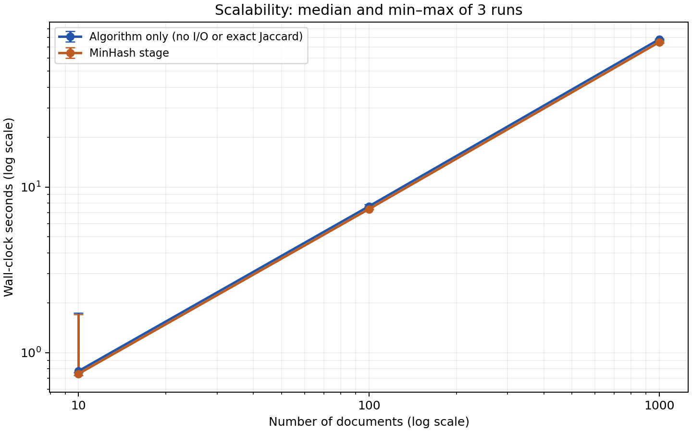

# Scalability evaluation: finding similar news documents

## Objective and similarity definition

We measured execution time for 10, 100, and 1,000 documents, as required by the assignment.
Two documents are similar exactly when the Jaccard similarity of their hashed character-shingle
sets is at least **s = 0.8**. Configuration: **k=10**, **120 MinHash components**, **seed=42**,
and **12 LSH bands × 10 rows**. Parameters and corpora were fixed before timing; the algorithms
were not retuned to improve the measured results.

## Data and reproducibility

All corpora concern the November 2026 US midterm election and its immediate coverage.
The largest corpus contains 200 real news texts (44 standalone articles and 156 live-blog updates)
and 800 explicitly labeled sentence-edit variants. These are **not 1,000 independent news articles**.
Each original has four variants; the nested smaller sets contain complete source families.
CBS accounts for most texts. The real-only 20-article corpus is a separate functional test,
not one of the timed scale corpora.

| N | Real texts | Artificial variants | Source families | Total words | Total unique shingles (summed over documents) |
| --- | --- | --- | --- | --- | --- |
| 10 | 2 | 8 | 2 | 2470 | 13101 |
| 100 | 20 | 80 | 20 | 23900 | 130707 |
| 1000 | 200 | 800 | 200 | 243225 | 1325505 |

Text lengths were balanced approximately across scales. Length tails, publisher mix, and
natural cross-family reuse still differ. The datasets are nested, not independent samples or
train/test splits. Details and source attribution: [dataset documentation](data/election_2026/README.md).

## Measurement protocol

- Three sequential measured repetitions at every size, preceded by one excluded 10-document warm-up.
- Wall-clock timing uses `time.perf_counter()`. Reported values are medians; raw repetitions and ranges are preserved.
- Every trial rereads documents and rebuilds shingles, signatures, and LSH buckets. No precomputed signatures are reused across trials.
- Manifest/checksum validation runs before timing. Files are loaded outside the algorithm timer; neither cold-disk nor warm-cache file-reading latency enters the reported algorithm time.
- Execution order is 10, 100, 1,000, repeated three times. Other host activity, scheduling, and CPU frequency are not controlled.
- **Algorithm time = setup + shingling + MinHash + LSH + candidate signature comparison.** Signature comparison is the assignment's CompareSignatures stage, using only candidate signatures.
- **Excluded: file reading, every exact Jaccard calculation (including candidate verification), ground-truth construction, precision/recall calculation, writing, printing, and plotting.**
- Exact Jaccard is computed after the algorithm stages solely for offline quality evaluation. Full-corpus ground truth includes cross-family pairs. MinHash-filtered candidates and LSH candidates are evaluated separately.
- Raw files retain separately measured validation and I/O durations as auxiliary diagnostics. They are never added to the reported algorithm time. The requested boundary was applied by summing the recorded algorithm stages per trial, without estimating or subtracting an assumed validation cost.
- Downloading, generation, validation and reporting are excluded. The benchmark does not execute the diagnostic all-pairs signature comparison used by the interactive `pipeline.py`.

Environment: Python 3.9.6 (default, Dec  2 2025, 07:27:59) ; Darwin 24.6.0;
process architecture x86_64; 12 logical CPUs reported, but a single
Python process with no explicit parallelism. Hardware model and RAM were not available from
the sandbox. UTC timestamps, exact configuration, and algorithm/input SHA-256 values are
stored in `results/scalability/benchmark.json`.

## Execution time

All numbers in the stage table are seconds, median of three measurements.

| N | Setup | Shingling | MinHash | LSH | Signature compare | Algorithm total |
| --- | --- | --- | --- | --- | --- | --- |
| 10 | 0.000380 | 0.028391 | 0.746020 | 0.000206 | 0.000174 | 0.775058 |
| 100 | 0.000398 | 0.276657 | 7.354960 | 0.008219 | 0.001416 | 7.646833 |
| 1000 | 0.000390 | 2.961405 | 74.846946 | 0.090827 | 0.018505 | 77.926033 |

Each stage median is calculated independently; their sum need not equal the median total.
Totals are calculated per trial before taking the median. Min/max are observed ranges,
not confidence intervals.

| N | Algorithm median (s) | Minimum (s) | Maximum (s) | Median ms/document |
| --- | --- | --- | --- | --- |
| 10 | 0.7751 | 0.7598 | 1.7327 | 77.506 |
| 100 | 7.6468 | 7.6149 | 7.8384 | 76.468 |
| 1000 | 77.9260 | 76.6850 | 78.5067 | 77.926 |

The last column normalizes algorithm time by document count. No exact-Jaccard validation
or file I/O is included in either the tables or the figure.



## Detection quality against exhaustive Jaccard

| N | All pairs | Exact positives | Candidates | TP | FP | FN | Candidate precision | Recall | Pair reduction |
| --- | --- | --- | --- | --- | --- | --- | --- | --- | --- |
| 10 | 45 | 9 | 12 | 9 | 3 | 0 | 75.00% | 100.00% | 73.33% |
| 100 | 4950 | 85 | 105 | 74 | 31 | 11 | 70.48% | 87.06% | 97.88% |
| 1000 | 499500 | 921 | 1175 | 876 | 299 | 45 | 74.55% | 95.11% | 99.76% |

TP = candidates whose exact Jaccard is at least 0.8; FP = candidates below 0.8;
FN = true similar pairs not proposed by LSH. Pair reduction compares candidate count
with N(N−1)/2 possible pairs. It is a reduction in exact pair comparisons, not a wall-time speedup.
Offline exact verification would remove all candidate false positives; the verified subset
has precision 1.0, while recall remains the LSH recall shown above. This verification
is excluded from algorithm timing.
Detailed positives, candidates, and missed pairs are in `results/scalability/pairs_N.json`.
At N=1000, 50 true positive pairs connect different source families;
using only planted within-family labels would miss these ground-truth relationships.

For comparison, filtering candidates solely with the MinHash estimate ≥ 0.8 gives:

| N | MinHash-filtered candidates | Precision | Recall | Missed true pairs |
| --- | --- | --- | --- | --- |
| 10 | 11 | 81.82% | 100.00% | 0 |
| 100 | 83 | 84.34% | 82.35% | 15 |
| 1000 | 899 | 90.88% | 88.71% | 104 |

This optional filtering can add false negatives or retain false positives because MinHash
is an estimate. Repeating timings with the same seed leaves all candidate counts and quality
metrics identical; these repetitions do not measure variability over random hash families.

## Interpretation

All reported scalability times exclude exact Jaccard and evaluation. Candidate reduction is reported separately as an algorithm property, not as a measured end-to-end speedup.

At N=1000, MinHash construction accounts for approximately 96.0% of median
algorithm time. The current implementation evaluates each of the 120 arithmetic hash functions
for every unique shingle in Python, making signature construction the dominant cost.

- 10 to 100 documents: algorithm-only time increased 9.87x for a 10x input increase (two-point exponent 0.99).
- 100 to 1000 documents: algorithm-only time increased 10.19x for a 10x input increase (two-point exponent 1.01).

With average shingle count M and signature length H fixed, signature construction is O(NMH).
Exhaustive exact comparison is O(N²M). LSH bucket insertion reads O(NH) signature components,
but pair enumeration costs the sum of binomial(bucket size, 2) over buckets, including repeated
pairs across bands. Candidate deduplication and exact verification then depend on the emitted
pairs and C unique candidates. Candidate signature comparison costs O(CH). Exact candidate
verification would cost O(CM), but is outside the reported timing. Worst-case LSH work remains
quadratic for large matching buckets.
Only three sizes and three timing repetitions were measured, so the observed slopes do not
prove an asymptotic complexity or predict a crossover at larger N.

Under the ideal independent MinHash model, the probability of retrieving a pair with true
similarity j is 1−(1−j^10)^12, approximately 0.744 at j=0.8. The affine hash family used here
approximates random permutations; the formula is a design model, not a strict guarantee for
this fixed seed. Exact verification cannot recover pairs missed during candidate generation.

## Reproduce

```bash
python3 scripts/dataset_archive.py import --archive /path/to/election_2026_1000.zip
python3 scripts/build_election_dataset.py --verify-only
python3 scripts/benchmark_scalability.py --repeats 3
python3 scripts/report_scalability.py
```

The benchmark uses the standard library and existing algorithm modules. The optional report
figure requires matplotlib (`python3 -m pip install matplotlib`). The fixed 1,000-document
ZIP is distributed separately through a cloud drive; texts and archives are Git-ignored.
Download from the [Google Drive dataset folder](https://drive.google.com/drive/folders/12gJchd3Gv5oO9GsbdZrfX5CRR0VNfaGZ);
import instructions are in `data/election_2026/DOWNLOAD.md`.
The importer verifies the original hashes and restores all subsets without recollection.
The CSV file contains all nine raw trials; the JSON also contains
medians, min/max, quality metrics, environment, and input fingerprints.
